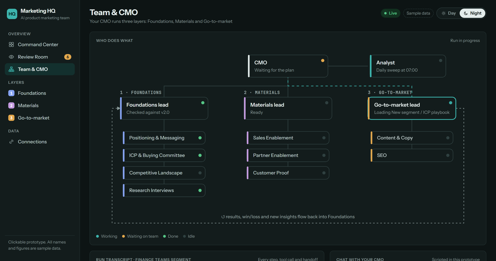
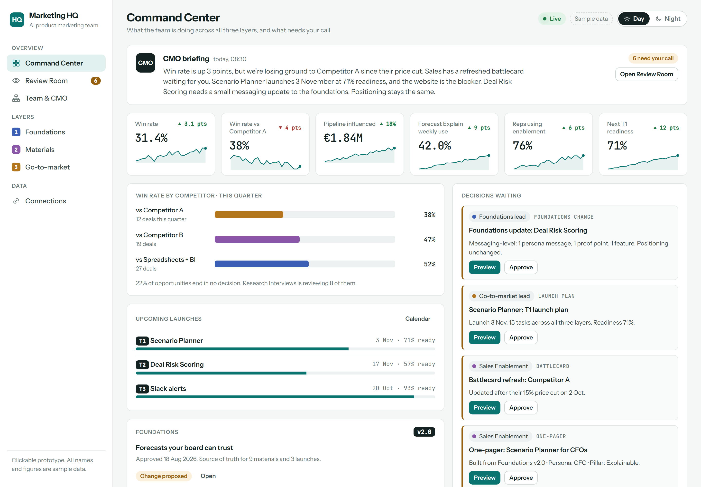
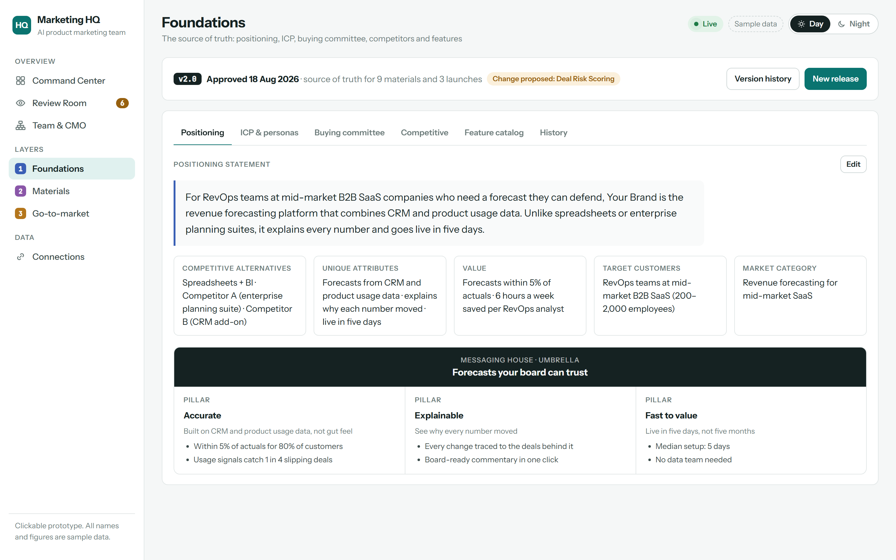
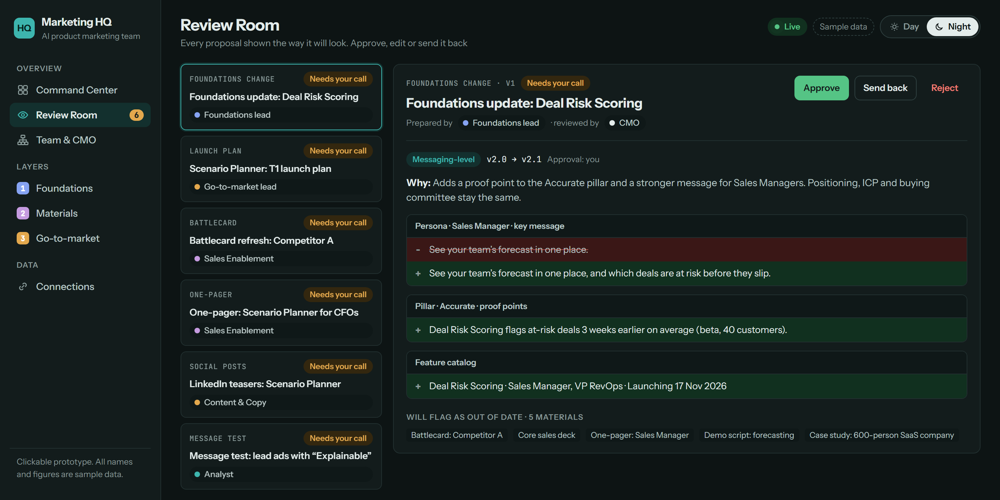
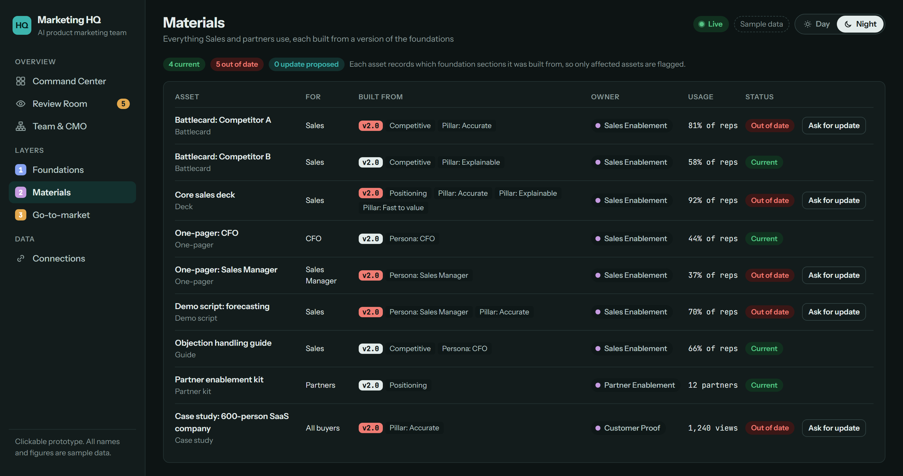

# Marketing HQ

An AI product marketing team run from one live web app.

An **AI CMO** orchestrates the team. The work runs in **three layers**, the way product marketing actually works:

1. **Foundations:** positioning, ICP and personas, buying committee (DMU), competitive landscape, research interviews. This is the versioned **source of truth**.
2. **Materials:** sales enablement, partner enablement and customer proof, each built from a specific version of the foundations.
3. **Go-to-market:** launches (tiers, readiness boards) and campaigns from playbooks.

Results and insights flow back into Foundations. When the foundations change, only the materials built on the changed sections are flagged as out of date. Nothing goes live without human approval, and every proposal is reviewed the way it will actually look.

## Status

**Phase 0: clickable prototype.** A single HTML file with sample data and no backend yet. It has a Day/Night switch in the top bar.

Open `prototype/index.html` in a browser. Things to try:

- **Foundations → New release:** check how a release affects the foundations.
  - "Dark mode" is added to the feature catalog only.
  - "Deal Risk Scoring" proposes v2.1.
  - "Board Reporting" proposes v3.0.
- **Review Room:** approve the v2.1 diff, then open **Materials** to see exactly which assets were flagged.
- **Go-to-market → New launch or campaign:** pick one of 8 playbooks and send it to the CMO. Then watch the three layers work on **Team & CMO**.
- **Team & CMO:** ask the CMO to change positioning, or to add a second T1 launch. It pushes back when the evidence or capacity isn't there.

| | |
|---|---|
|  |  |
|  |  |

## Roadmap

| Phase | What |
|---|---|
| 0 | Clickable prototype ✅ |
| 1 | Foundation: monorepo, database, live mock connectors, Command Center, Foundations library with versioning |
| 2 | Agent team on the Claude Agent SDK (CMO, Analyst, layer leads, first specialists), Review Room, release impact check |
| 3 | Real connectors: Salesforce/HubSpot, Jira, Gong, Amplitude, Highspot, G2 |
| 4 | Remaining specialists, Markdown export of foundations to Git, Notion sync, auth, cloud deploy |

The full plan, covering architecture, agents, versioning, playbooks and data model, is in [docs/PLAN.md](docs/PLAN.md).

## Planned stack

Next.js · Fastify · Socket.IO · Claude Agent SDK · SQLite with Drizzle (Postgres later) · TypeScript · pnpm workspaces
