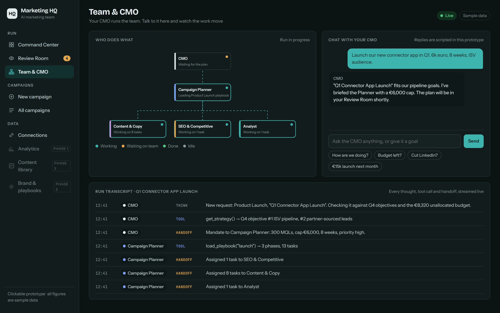

# Marketing HQ

An AI marketing team run from one live web app.

An **AI CMO** (the orchestrator) owns strategy, priorities and budget. It briefs a **Campaign Planner**, which picks the campaign type, loads that type's playbook and hands tasks to specialist agents (**Content & Copy**, **SEO & Competitive**, **Analyst**). Nothing goes live without human approval, and every proposal is reviewed as a visual preview of how it will actually look.

## Status

**Phase 0: clickable prototype.** A single HTML file with sample data. No backend yet.

Open `prototype/index.html` in a browser. Screens:

- **Command Center**: CMO briefing, live KPIs, leads by channel, decisions waiting, activity feed
- **New campaign**: pick one of 8 campaign types, set the goal and budget, preview the playbook, send it to the CMO
- **Team & CMO**: live org chart, chat with the CMO, run transcript
- **Review Room**: campaign plan (timeline, budget, funnel), LinkedIn post and email mockups, budget decision chart. Approve, edit, reject or send back with a comment.
- **Connections**: HubSpot, LinkedIn, GA4 and Google Ads on mock data

## Roadmap

| Phase | What |
|---|---|
| 0 | Clickable prototype ✅ |
| 1 | Foundation: monorepo, database, live mock connectors, Command Center and Analytics |
| 2 | Agent team on the Claude Agent SDK, with the Visual Review Room |
| 3 | Real connectors: HubSpot, GA4, Google Ads, LinkedIn |
| 4 | More agents (Paid Ads, Social Media, Email & Automation, Design, Events), more connectors, auth, cloud deploy |

The full plan, covering architecture, data model, agents, playbooks and wireframes, is in [docs/PLAN.md](docs/PLAN.md).

## Planned stack

Next.js · Fastify · Socket.IO · Claude Agent SDK · SQLite with Drizzle (Postgres later) · TypeScript · pnpm workspaces
